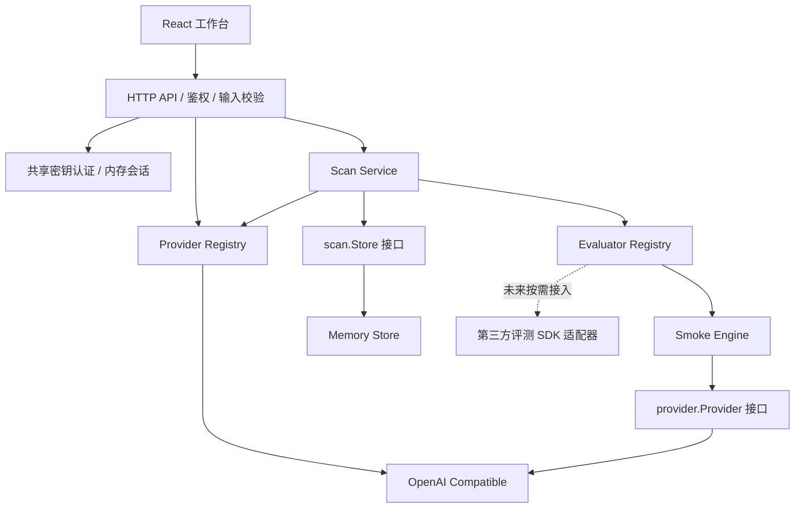

# 架构

## 当前实现

前端是 React + TypeScript + Vite，后端是 Go 标准库 HTTP 服务。数据库、任务队列和第三方评测运行时不是启动前置条件。

`cmd/server` 是依赖装配位置。注册表启动时构建，运行期间只读；重复 ID 会导致启动失败，不能静默覆盖。扫描服务依赖 Store 接口而不是具体内存实现，外部 SDK 仅应依赖 `pkg` 中的契约。

## 两类扩展

**Provider** 负责模型发现和文本调用，将协议映射为 `provider.Model` / `provider.Completion`。它不知道评测标准。内置适配器有单请求超时、响应大小上限，并禁止跟随重定向，避免凭据被转发。

**Evaluator** 拥有检测方法，可执行一次、多次或多轮模型调用，返回结构化检查证据。版本号随任务快照保存。核心不导入题库 SDK、不做隐式 LLM judge 调用；内置 smoke 引擎用确定性校验完成三项检查。

当前没有通用分数可比性假设。页面分别统计 `passed`、`failed`、`error`，不把 HTTP 错误作为智力分数。

## 任务生命周期

1. HTTP 层校验厂商 ID、完整 URL、API Key、scope、模型 ID 和 evaluator ID。
2. 创建 `pending` 任务并返回 `202`。任务使用服务生命周期 context，HTTP 请求结束不取消异步任务。
3. `scope=all` 调用模型发现；`scope=selected` 直接使用输入模型 ID，去重后保持输入顺序。
4. 任务进入 `running`，每个模型依次由选定引擎执行；模型完成后保存快照，页面轮询读取。
5. 所有检查正常执行时任务为 `completed`，即使有检查未通过；存在调用或引擎错误时为 `completed_with_errors`。发现失败、空列表或服务取消为 `failed`。
6. `completed_at` 只在任务终止时设置。SIGINT/SIGTERM 取消外部请求，HTTP 服务停止接收新任务并等待任务退出。

同一任务内部串行，多个 API 请求可创建并行任务；当前没有队列、全局限流或自动重试。前端在当前任务运行期间禁用重复提交，但这不是服务端并发上限。

## 凭据与信任边界

- 登录密钥由环境变量提供；服务保存比较用的 SHA-256 摘要，常量时间比较后生成随机会话 token。
- 会话在服务内存中保存 TTL，浏览器仅在 React state 中保存 token。注销调用后端撤销 token；刷新页面需要重新登录。
- 所有用户共享部署级权限、历史任务和结果。需要用户隔离时必须先引入账户与资源归属模型。
- 模型 API Key 只在页面和任务上下文中使用。Store 中的 Scan 不含 Connection。
- 上游错误体不外传；结果输出先替换本次 API Key，再保留最多 1000 个 Unicode 字符。这个机制不能覆盖上游返回的任意其他秘密。
- URL 允许 HTTP(S) 与内网目标，不允许 userinfo、query、fragment。当前定位是受信任操作台；公网多用户使用需要额外的出站策略。

## 后续替换点

引入持久化时实现 `scan.Store`，同时设计启动任务恢复；仅替换 Store 不能让正在执行的任务自动恢复。当前没有数据库迁移目录，因为还没有数据库 schema。

异构 SDK 优先使用独立 module 或独立 worker。worker 通信、凭据传递、取消和错误协议需要在选定第一个 SDK 时设计，当前不提前引入空 RPC 层。
